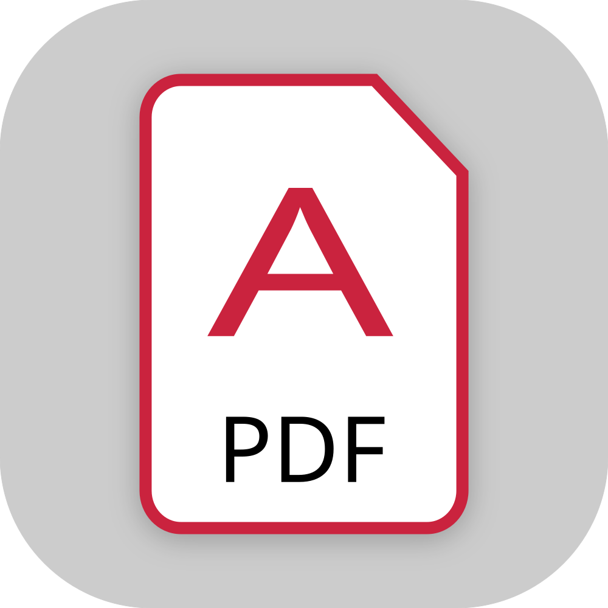

  <a href="https://example.com/">
    <picture>
      <source media="(prefers-color-scheme: dark)" srcset="assets/brand/mantevedau_mini_w.svg">
      
    </picture>
  </a>

  

<h1 align="center">Program</h1>

A universal converter that turns any text-based file into a PDF document, treating its contents as plain text regardless of the original file format.

  <a href="https://getartcraft.com/apps/photocraft"><b>PhotoCraft on getartcraft.com</b></a> ·
  <a href="https://getartcraft.com/">ArtCraft</a> ·
  <a href="https://getartcraft.com/apps">All Crafting Apps</a>

  
   
  

## Languages

English / [Russian](readme/README_ru.md)

## Third-party

* Liberation Fonts ([SIL Open Font License 1.1](https://github.com/liberationfonts/liberation-fonts/blob/main/LICENSE))
